# Proyecto 1 · Mi web en AWS: Librería Tinta

* **Alumna:** Mª Inés Antón Castelló
* **Entorno:** AWS Academy Learner Lab · Región `us-east-1` (Virginia del norte)
<!-- * **Vídeo demostración:** [Ver vídeo en YouTube / Drive](https://enlace) -->

---

## 1. Arquitectura del proyecto

A continuación se muestra el diagrama de la infraestructura desplegada en `us-east-1` (Virginia del norte):

  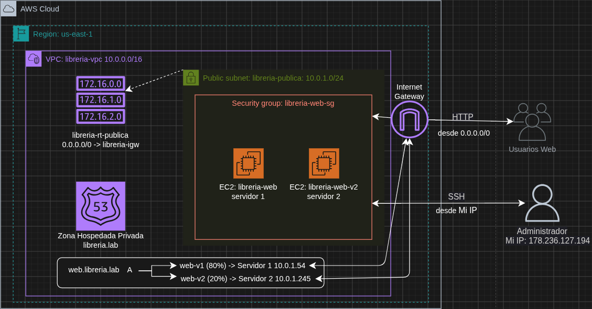

---

## 2. Nivel Básico

### B1. Diseño de red (VPC)

Se han creado manualmente los siguientes recursos en `us-east-1` (Virginia del norte):

* **VPC (`libreria-vpc`):** 
  * **Bloque CIDR:** `10.0.0.0/16`
  * **Opciones DNS:** Habilitadas *Resolución de DNS* y *Nombres de host DNS* (necesarias para el enrutamiento ponderado con Route 53 del apartado 3).
  
  
* **Subred pública (`libreria-publica`):** Bloque CIDR `10.0.1.0/24` en la zona de disponibilidad `us-east-1a`, con asignación automática de IPv4 pública activada.
  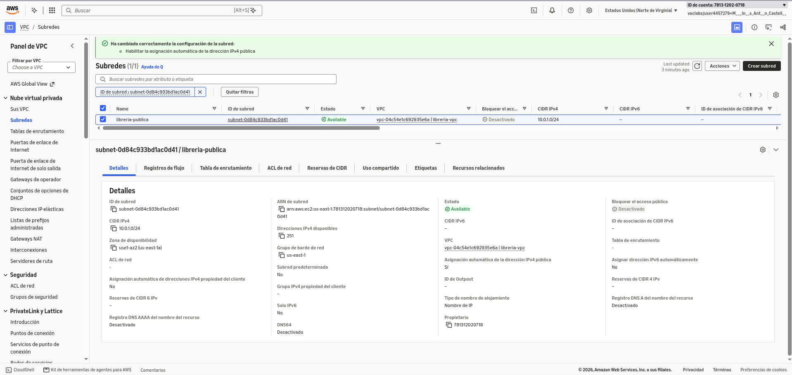
  
* **Internet Gateway (`libreria-igw`):** Asociado a `libreria-vpc`.
  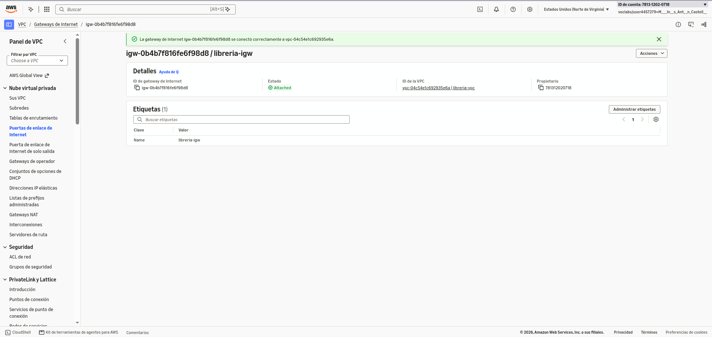
  
* **Tabla de rutas (`libreria-rt-publica`):** Ruta por defecto `0.0.0.0/0` apuntando a `libreria-igw` y asociada explícitamente a `libreria-publica`.
  
  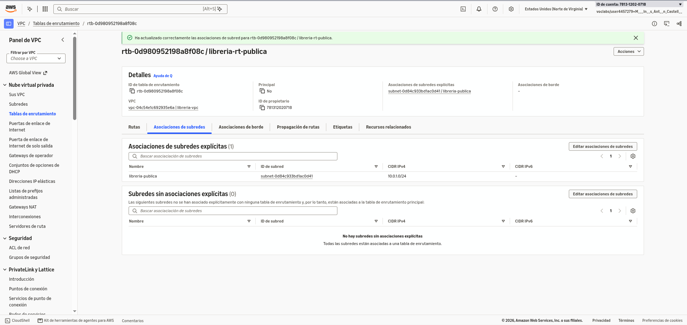

> **¿Por qué es pública esta subred?**  
> Porque tiene asociada una tabla de rutas que dirige todo el tráfico saliente hacia Internet (`0.0.0.0/0`) a través de la puerta de enlace (`libreria-igw`).

### B2. Seguridad (Security Group)

Se ha creado el grupo de seguridad `libreria-web-sg` dentro de `libreria-vpc` con las siguientes reglas de entrada:

* **HTTP (TCP 80):** Origen `0.0.0.0/0` (acceso público para los clientes de la web).
* **SSH (TCP 22):** Origen `178.236.127.194/32` (acceso restringido únicamente al administrador).

  

> **¿Por qué el puerto SSH sólo se abre a mi IP?**  
> Porque desde este puerto se permite el acceso remoto y la administración total del servidor. Al restringirlo sólo para mi IP pública, se evitan ataques de fuerza bruta y accesos no autorizados desde cualquier otro punto de Internet.

### B3. Servidor web (EC2)

Se ha lanzado la instancia `libreria-web` (`t3.micro`, Amazon Linux 2023) en `libreria-publica` utilizando el script [`scripts/user-data1.sh`](scripts/user-data1.sh) para instalar y arrancar Nginx automáticamente.

* **Detalles y etiquetas de la instancia:**
  
  
  
* **Comprobación de la web en el navegador:**
  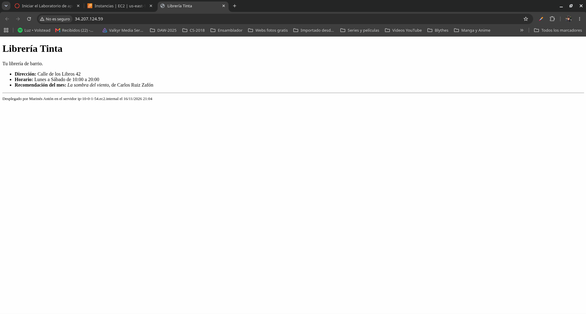

### B4. Cálculo de costes

* **Enlace a la estimación:** [Ver presupuesto en AWS Pricing Calculator](https://calculator.aws/#/estimate?id=97c533bac7a8eca4fbb5786f06c2df1b67328e78)
* **Coste mensual estimado:** ~8,23 USD/mes (1 instancia `t3.micro` Linux On-Demand funcionando 24/7 + 8 GB de almacenamiento EBS `gp3` en `us-east-1`).
* **Cómo abaratar el coste:** Dado que es una librería de barrio y el tráfico de madrugada es nulo, se podría reducir el gasto programando el apagado automático de la instancia fuera del horario comercial con *AWS Instance Scheduler*, cambiando a una instancia ARM más económica como `t4g.micro`, o contratando un *EC2 Instance Savings Plan* a 1 o 3 años.

  

---

## 3. Nivel Medio (DNS ponderado con Route 53)

### M1. Configuración de Route 53 y reparto 80/20

1. Anteriormente, en el apartado B1, ya se habilitaron las opciones *Resolución de DNS* y *Nombres de host DNS* en la VPC `libreria-vpc`.
2. Se ha desplegado una segunda instancia (`libreria-web-2`) usando [`scripts/user-data2.sh`](scripts/user-data2.sh).
  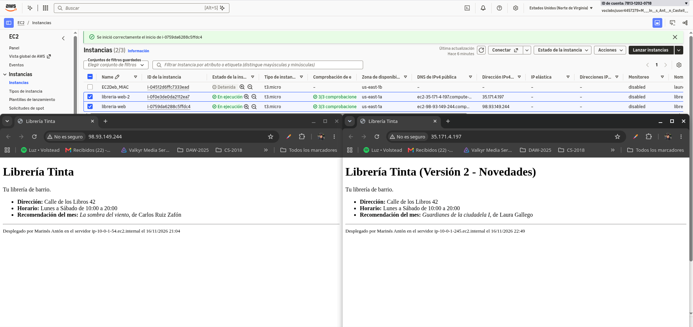

3. Se ha creado una **Private Hosted Zone** llamada `libreria.lab` asociada a `libreria-vpc` con dos registros `A` ponderados para `web.libreria.lab`:
   * **Servidor 1 (`10.0.1.54`):** Peso `80`
   * **Servidor 2 (`10.0.1.245`):** Peso `20`
  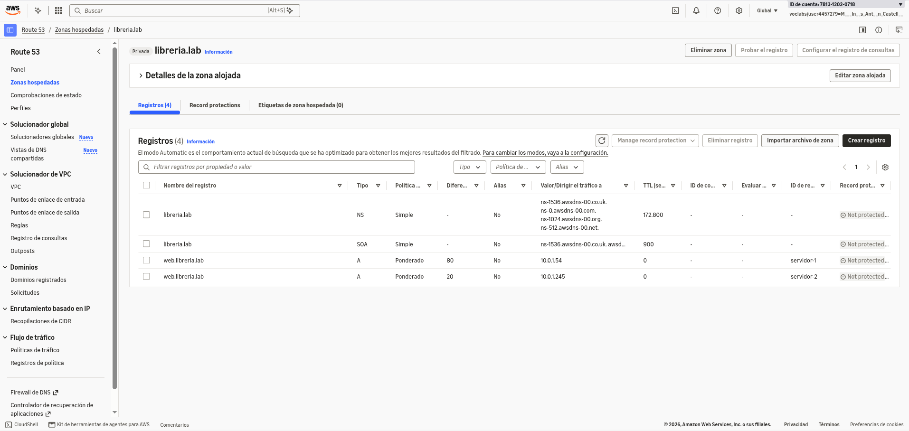

* **Comprobación desde dentro de la VPC (`dig` y `curl`):**

```bash
# Instalar el paquete bind-utils para disponer del comando 'dig' por si no viene preinstalado en la instancia
sudo dnf install -y bind-utils

# Devuelve una sola IP privada (puede ser distinta cada vez que se ejecute)
dig +short web.libreria.lab

# Bucle que imprime 2 líneas con el recuentro del tráfico redirigido a cada versión
for i in $(seq 1 30); do dig +short web.libreria.lab; done | sort | uniq -c

# Bucle para ver de forma más gráfica las peticiones, filtrando sólo el título de la web
for i in {1..20}; do curl -s [http://web.libreria.lab](http://web.libreria.lab) | grep "<h1>"; done
```

  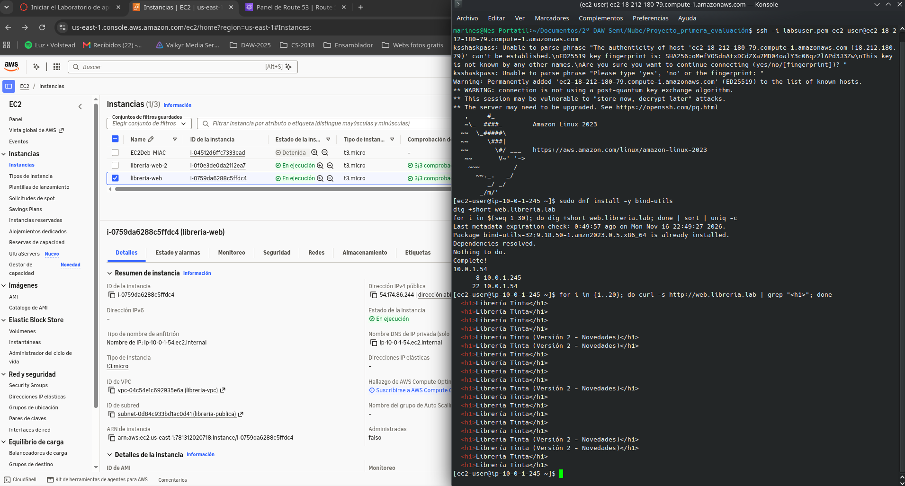

### M2. Actualización del coste

* **Enlace a la estimación actualizada:** [Ver presupuesto Nivel Medio](https://calculator.aws/#/estimate?id=26221a6957804138287c52f2e1e67863a82c96fc)
* **Coste mensual estimado:** ~16,46 USD/mes (2 instancias `t3.micro` 24/7 + 1 zona hospedada en Route 53).
* **Comparativa y justificación:** El coste aumenta aproximadamente al doble respecto al nivel básico al incorporar una segunda instancia y la zona hospedada (aunque esta sólo suma 0,9 USD/mes).

  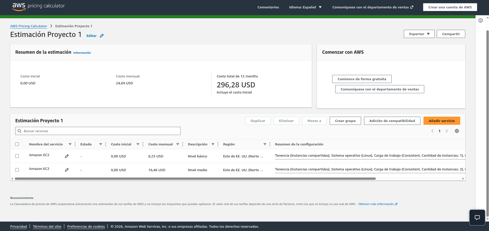

---

## 4. Nivel Avanzado (Automatización con AWS CLI)

Para automatizar el despliegue sin depender de la consola web, se ha desarrollado el script [`scripts/desplegar.sh`](scripts/desplegar.sh), que ejecuta secuencialmente las siguientes tareas mediante la terminal de  **AWS CLI**:

1. Obtiene dinámicamente el ID de la última AMI oficial de **Amazon Linux 2023**.
2. Crea el grupo de seguridad (`libreria-web-cli-sg`) y configura las reglas de entrada para los puertos **80 (HTTP)** y **22 (SSH)**.
3. Lanza la instancia EC2 asociando el script de arranque [`scripts/user-data1.sh`](scripts/user-data1.sh).
4. Espera a que la máquina esté en estado `running` y devuelve por pantalla su dirección **IP pública**.

### Ejecución del script

> **Nota:** Dado que el comando `aws ec2 run-instances` referencia el archivo mediante la ruta relativa `file://user-data1.sh`, ambos scripts deben estar en la misma carpeta.

```bash
# Entrar al directorio de scripts, dar permisos de ejecución al propietario y lanzar el despliegue
chmod 700 desplegar.sh
./desplegar.sh
```

* **Salida de la ejecución en terminal:**
  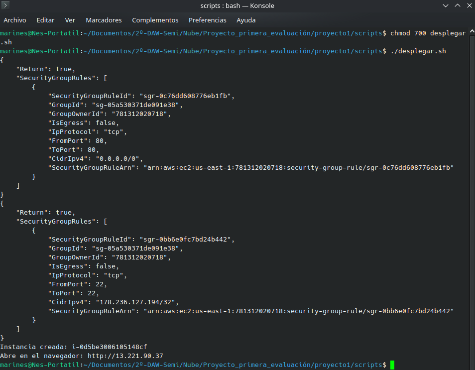
* **Web desplegada por el script:**
  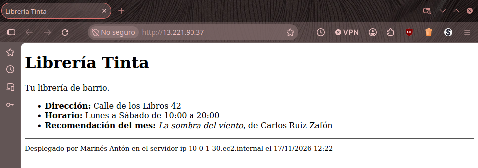

---

## 5. Uso de inteligencia artificial

* **Herramienta utilizada:** Gemini (Google)
* **Prompts útiles empleados:**
  * *"Dame una plantilla completa en Markdown para el README.md que cumpla con todos los requisitos de entrega del proyecto, incluyendo el cálculo de costes y que la tenga que rellenar yo."*
  
* **Uso y revisión de la respuesta:** La estructura generada se utilizó como plantilla base para organizar las secciones de la memoria técnica, adaptando posteriormente todos los apartados, nombres de recursos, capturas y cálculos reales de mi entorno en AWS.
