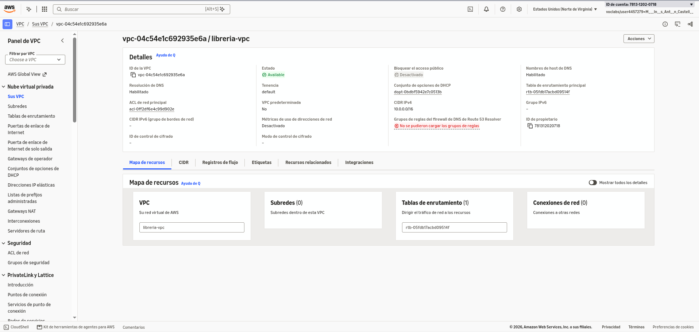
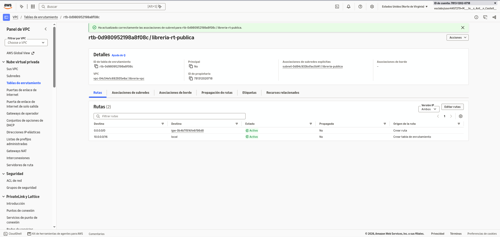
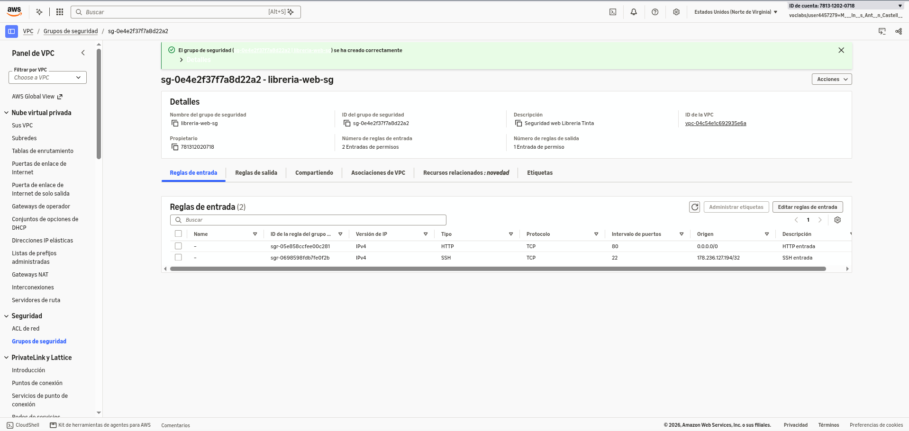
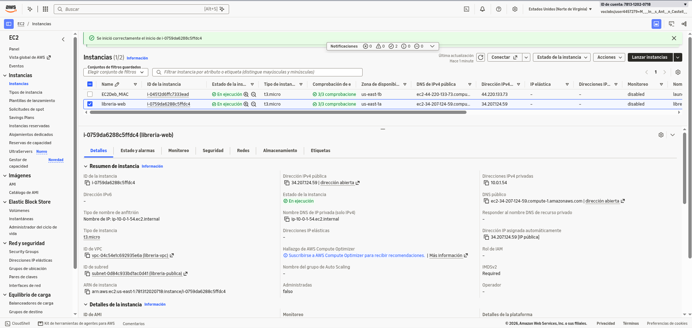
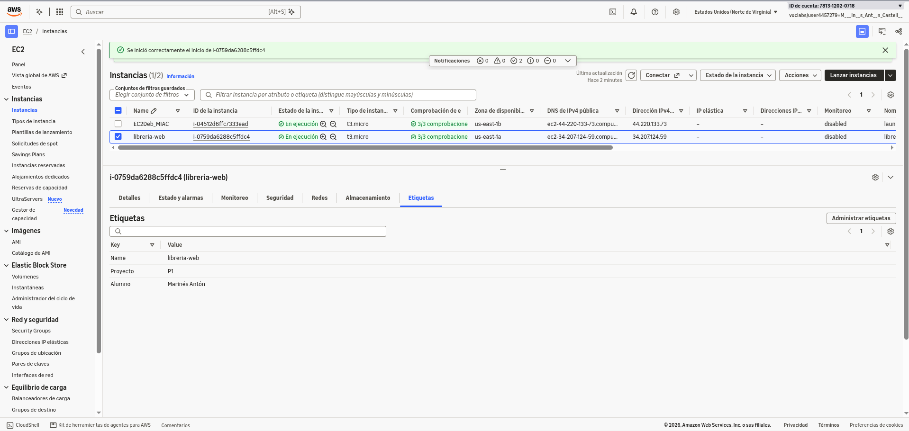
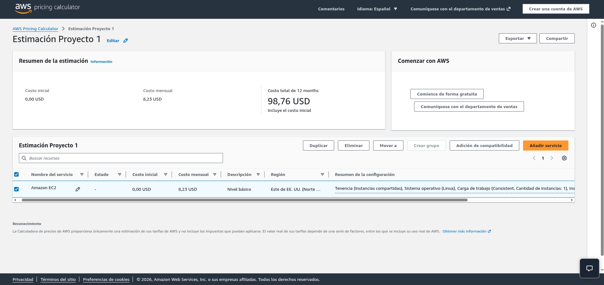

# Proyecto 1 · Mi web en AWS: Librería Tinta

* **Alumna:** <Mª Inés Antón Castelló>
* **Entorno:** AWS Academy Learner Lab · Región `us-east-1`
* **Vídeo demostración:** [Ver vídeo en YouTube / Drive](https://enlace)

---

## 1. Arquitectura del proyecto

A continuación se muestra el diagrama de la infraestructura desplegada en `us-east-1`:

---

## 2. Nivel Básico

### B1. Diseño de red (VPC)

Se han creado manualmente los siguientes recursos en `us-east-1`:

* **VPC (`libreria-vpc`):** Bloque CIDR `10.0.0.0/16`.
  
* **Subred pública (`libreria-publica`):** Bloque CIDR `10.0.1.0/24` en la zona de disponibilidad `us-east-1a`, con asignación automática de IPv4 pública activada.
  
* **Internet Gateway (`libreria-igw`):** Asociado a `libreria-vpc`.
  
* **Tabla de rutas (`libreria-rt-publica`):** Ruta por defecto `0.0.0.0/0` apuntando a `libreria-igw` y asociada explícitamente a `libreria-publica`.
  
  

> **¿Por qué es pública esta subred?**  
> Porque tiene asociada una tabla de rutas que dirige todo el tráfico saliente hacia Internet (`0.0.0.0/0`) a través de la puerta de enlace (`libreria-igw`).

### B2. Seguridad (Security Group)

Se ha creado el grupo de seguridad `libreria-web-sg` dentro de `libreria-vpc` con las siguientes reglas de entrada:

* **HTTP (TCP 80):** Origen `0.0.0.0/0` (acceso público para los clientes de la web).
* **SSH (TCP 22):** Origen `178.236.127.194/32` (acceso restringido únicamente al administrador).

> **¿Por qué el puerto SSH sólo se abre a mi IP?**  
> Porque desde este puerto se permite el acceso remoto y la administración total del servidor. Al restringirlo sólo para mi IP pública, se evitan ataques de fuerza bruta y accesos no autorizados desde cualquier otro punto de Internet.

### B3. Servidor web (EC2)

Se ha lanzado la instancia `libreria-web` (`t3.micro`, Amazon Linux 2023) en `libreria-publica` utilizando el script [`scripts/user-data1.sh`](scripts/user-data1.sh) para instalar y arrancar Nginx automáticamente.

* **Detalles y etiquetas de la instancia:**
  
  
  
* **Comprobación de la web en el navegador:**
  

### B4. Cálculo de costes

* **Enlace a la estimación:** [Ver presupuesto en AWS Pricing Calculator](https://calculator.aws/#/estimate?id=97c533bac7a8eca4fbb5786f06c2df1b67328e78)
* **Coste mensual estimado:** ~8,23 USD/mes (1 instancia `t3.micro` Linux On-Demand funcionando 24/7 + 8 GB de almacenamiento EBS `gp3` en `us-east-1`).
* **Cómo abaratar el coste:** Dado que es una librería de barrio y el tráfico de madrugada es nulo, se podría reducir el gasto programando el apagado automático de la instancia fuera del horario comercial con *AWS Instance Scheduler*, cambiando a una instancia ARM más económica como `t4g.micro`, o contratando un *EC2 Instance Savings Plan* a 1 o 3 años.

---

## 3. Nivel Medio (DNS ponderado con Route 53)

### M1. Configuración de Route 53 y reparto 80/20
  
### M2. Actualización del coste

## 4. Nivel Avanzado (Automatización con AWS CLI)

## 5. Uso de inteligencia artificial

* **Herramienta utilizada:** Gemini (Google)
* **Prompts útiles empleados:**
  1. *"Dame una plantilla completa en Markdown para el README.md que cumpla con todos los requisitos de entrega del proyecto, incluyendo el cálculo de costes y que la tenga que rellenar yo."*
  
* **Error o propuesta incorrecta detectada y corregida:**
  * *Propuesta inicial:* 
  * *Comprobación y corrección:* 
